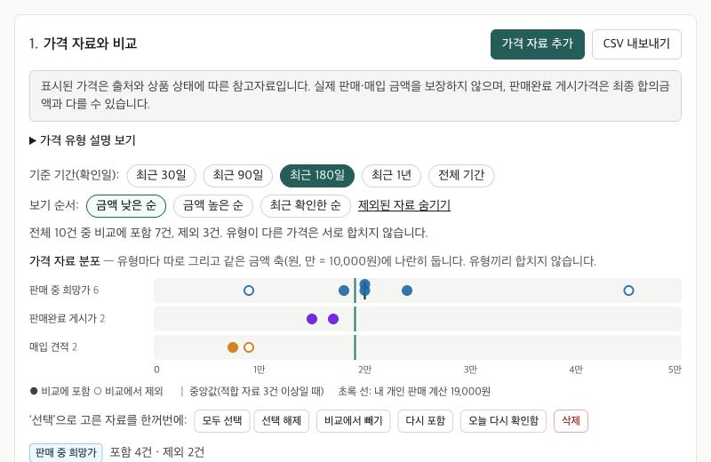
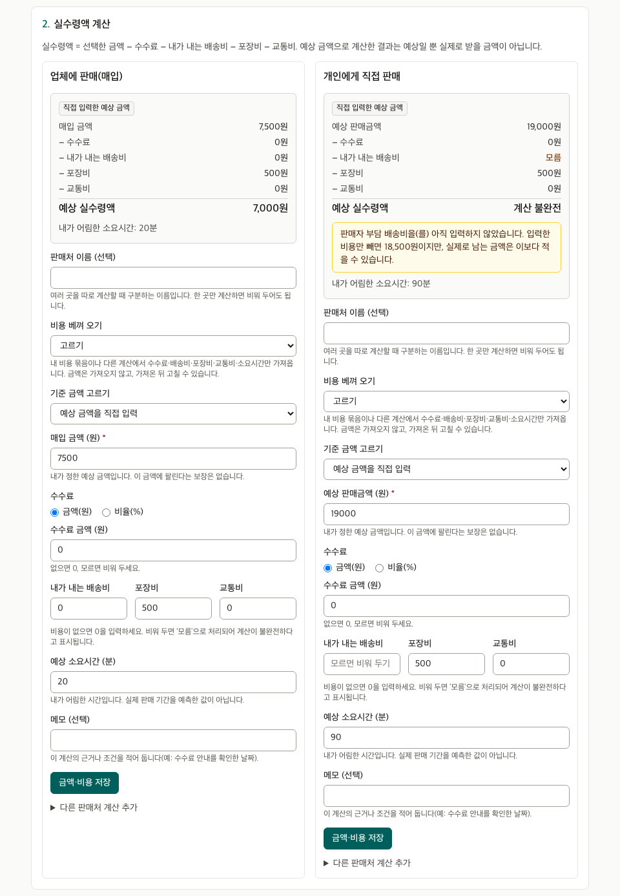
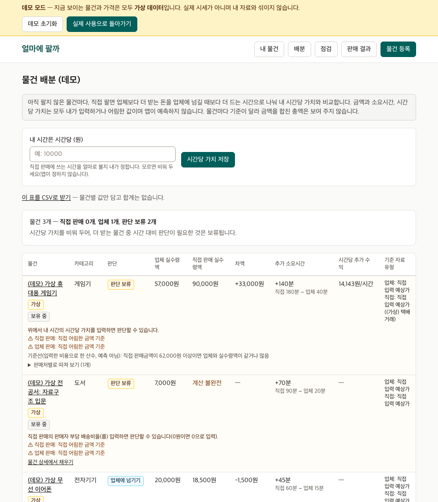

# 얼마에 팔까 (`resale-helper`)

집에 있는 전공책·게임기·전자기기를 팔기 전, 가격 자료와 비용을 정리해 직접 판매와 매입업체 이용을 숫자대로 비교하는 **개인용 로컬 도구**입니다.

| 물건 상세: 유형별 가격 비교 | 실수령액 계산: 빈칸은 "모름" → 계산 불완전 |
|---|---|
|  |  |



<sub>화면은 모두 데모 모드의 가상 데이터입니다. 실제 시세가 아닙니다.</sub>

---

## 설계 특징

이 도구는 가격을 예측하거나 판매 방법을 대신 추천하지 않습니다. 사용자가 확인한 자료와 비용으로 계산만 수행하며, 세 가지 원칙을 따릅니다.

1. **성격이 다른 가격 유형을 섞지 않습니다**
   - `판매 중 희망가(ASKING)`, `판매완료 게시가(SOLD_LISTING)`, `매입 견적(BUYBACK_QUOTE)`, `직접 입력한 거래가(USER_REPORTED)`를 하나의 평균값으로 합치지 않고 유형별로 따로 비교합니다.
2. **'모름'과 '0원'을 구분합니다**
   - 수수료·배송비·포장비·교통비 중 하나라도 비워 두면 0원으로 추측하지 않고 `계산 불완전`으로 표시합니다.
3. **시간당 가치로 나누되, 모르는 값이 있으면 판단을 보류합니다**
   - 물건 배분(`/triage`)은 `(직접 판매 실수령액 − 업체 실수령액) ÷ 추가 소요시간`을 사용자가 입력한 시간당 가치와 비교해 `직접 판매` / `업체`로 나눕니다. 비용·시간·시간당 가치 중 빈칸이 있으면 추측하지 않고 `판단 보류`로 둡니다.
   - 업체 계산의 기준 자료가 유효하고 이상이 없을 때는, 개인 판매금액이 얼마 이상이어야 업체와 같아지는지(손익분기 기준선)도 함께 보여 줍니다.

---

## 크롤링 없이 자료를 모으는 방식

이 저장소에는 중고 플랫폼을 자동으로 긁어오는 크롤러나 수집기가 없습니다. 대신 사용자가 직접 확인한 자료만 넣는 세 가지 입력 경로를 둡니다.

- **브라우저 확장 "직접 담기"**: 매물 상세 페이지를 보다가 버튼을 누를 때만 현재 탭(`activeTab`)의 가격·상태를 읽어 로컬 앱으로 보냅니다. 매물 사이트로는 아무 요청도 보내지 않습니다.
- **가져오기 API (`POST /api/import/prices`)**: 사용자가 만든 로컬 도구가 JSON으로 가격 자료를 넣을 수 있는 인증된 로컬 엔드포인트입니다. 기본은 꺼져 있으며 설정에서 토큰을 발급해야 열립니다.
- **직접 입력 및 CSV 가져오기**: 웹 화면에서 한 건씩 입력하거나 CSV 파일로 일괄 등록할 수 있습니다.

---

## 로컬 보안 설계

로그인 없이 `127.0.0.1`에서만 실행되는 로컬 서버를 다른 웹사이트의 브라우저 요청으로부터 보호하기 위해 다음 검사를 수행합니다.

- **Host 검증**: `localhost`, `*.localhost`, `127.0.0.1`, `[::1]`이 아닌 `Host` 헤더 요청은 403으로 거부합니다(DNS 리바인딩 방어).
- **Origin 및 토큰 검증**: 쓰기 API는 설정에서 발급한 토큰 해시를 확인하며, 일반 웹사이트에서 온 요청은 토큰이 맞아도 거부합니다(등록된 단일 브라우저 확장 또는 Origin이 없는 로컬 도구만 허용).
- **CSP 및 응답 헤더**: 스크립트는 요청마다 새 nonce로만 실행하고, 운영 빌드에는 `unsafe-eval`이 없습니다. 또한 `frame-ancestors 'none'`, `X-Frame-Options: DENY`, `Referrer-Policy: no-referrer`, `X-Content-Type-Options: nosniff`를 붙입니다.
- **CSV 수식 실행 방지**: CSV 내보내기 시 `=`, `+`, `-`, `@`, 탭, CR로 시작하는 글자 칸 앞에 `'`를 붙여 스프레드시트가 수식으로 실행하지 않게 합니다. 글자 칸만 처리하고 금액 같은 숫자 칸은 숫자로 둡니다.

---

## 실행 방법

- **요구 사항**: Node.js **22.13 이상**, pnpm **11**, macOS / Linux (`better-sqlite3` 네이티브 모듈 빌드)

```bash
pnpm install
pnpm db:migrate
pnpm dev
```

실행 후 브라우저에서 <http://127.0.0.1:3000> 을 엽니다. 서버는 `127.0.0.1`에만 열리며, 개인 자료는 `data/resale.db` 한 파일에 저장됩니다. 화면 맨 아래 "가상 데이터로 둘러보기(데모 보기)"를 누르면 실제 자료와 분리된 샘플 데이터로 기능을 둘러볼 수 있습니다.

- **테스트 및 빌드**: `pnpm lint` · `pnpm typecheck` · `pnpm test` · `pnpm build` · `pnpm test:e2e`
- **브라우저 확장 빌드**: `pnpm ext:build` (설치 및 토큰 연결 절차는 [docs/integrations.md](docs/integrations.md) 참고)
- **백업 및 복구**: 화면 하단에서 `.db` 백업 파일을 내려받을 수 있으며, 앱을 끈 뒤 `pnpm db:restore <백업 파일>`로 복구합니다.

---

## 상세 문서

- [제품 목표와 사용자 흐름](docs/product.md)
- [화면·산식·CSV 형식·백업 등 사용 안내](docs/usage.md)
- [비교·제외·중복·비용 계산 규칙](docs/pricing-methodology.md)
- [검토한 데이터 소스와 한계](docs/data-sources.md)
- [가져오기 API와 브라우저 확장 명세](docs/integrations.md)
- [후속 작업 목록](docs/roadmap.md)
- [보안 범위와 위협 모델](SECURITY.md) · [변경 이력](CHANGELOG.md)

---

## 알려진 한계

- 표시되는 가격은 출처와 상품 상태에 따른 참고 자료이며 **실거래가를 보장하지 않습니다.**
- 브라우저 확장은 버튼 클릭 시 현재 페이지의 구조를 읽으므로 **대상 사이트의 구조가 바뀌면 값을 읽지 못할 수 있습니다.** 이 경우 직접 입력이나 CSV 가져오기를 사용합니다.
- 단일 사용자 로컬(`127.0.0.1`) 도구로 설계되어 로그인 계정이 없으므로 인터넷이나 공유 네트워크에 공개 배포하지 마세요.
- 코드는 [MIT 라이선스](LICENSE)를 따르며, 앱에 입력하는 외부 가격 자료의 이용·재배포 권한은 각 출처의 약관을 따릅니다. 전체 한계 목록은 [docs/data-sources.md](docs/data-sources.md)와 [docs/pricing-methodology.md](docs/pricing-methodology.md)에서 확인할 수 있습니다.

---

## English Overview

`resale-helper` is a single-user, local-only web app (Next.js + SQLite) for deciding how to sell used books, consoles and electronics. It compares selling to a person yourself with selling to a buyback shop, using only numbers you enter. It does not predict prices or recommend what to do.

- **No scrapers.** Price records come from manual entry, CSV import, a token-protected local API (`POST /api/import/prices`), or a browser extension that reads only the open tab when you click it and sends nothing to marketplaces.
- **Conservative math.** Price types (asking price, sold listing, buyback quote, user-reported sale) are never averaged together. A blank cost means "unknown", not 0, so the result is shown as incomplete. The `/triage` view compares the extra money per extra hour of direct selling with your own hourly value, and withholds a verdict when any cost, time or hourly value is missing.
- **Local security.** The server listens on `127.0.0.1` only and rejects requests whose `Host` is not `localhost`, `*.localhost`, `127.0.0.1` or `[::1]` (DNS rebinding). The import API checks a token (stored only as a hash) and the request `Origin`. Scripts run only with a per-request CSP nonce (no `unsafe-eval` in production builds), and CSV exports escape text cells that a spreadsheet could run as formulas.
- **Language and sites.** The UI is in Korean. The extension has site-specific parsers for Daangn, Bunjang (listing number and URL only) and Joongna; on other sites it reads a page only when it publishes a single schema.org Product.

Quick start: Node.js 22.13+ and pnpm 11, then `pnpm install`, `pnpm db:migrate`, `pnpm dev`, and open <http://127.0.0.1:3000>. "가상 데이터로 둘러보기" at the bottom of the page opens demo data that is kept apart from your own records. Licensed under MIT.
